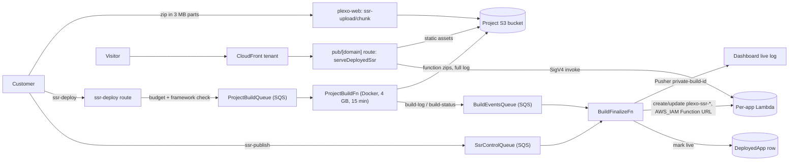

# Server apps (SSR) — architecture

Server-rendered apps (Next.js, Remix, Astro, Nuxt, Nitro) run as per-app AWS Lambda functions behind a CloudFront distribution. This doc covers the pipeline from upload to a live site. For the rest of the Projects platform, see [ARCHITECTURE.md](./ARCHITECTURE.md).

## Request and build flow

## Stages

### 1. Upload — `lib/projects/ssrUpload.ts`, `ssr-upload/chunk` route

- The zip is sent in 3 MB parts through plexo-web and staged in the project bucket. The browser never uploads to S3 directly.
- Limits: 100 MB zip, 10,000 files (`lib/projects/ssrSource.ts`).
- Only ULTRA-plan accounts can use server apps (`app/api/v1/templates/[id]/ssr-deploy/route.ts`).

### 2. Inspect and gate — `lib/projects/ssrSource.ts`, `lib/projects/ssrBudget.ts`

- `package.json` decides the framework: Next.js, Remix, Astro, Nuxt, or Nitro (`detectSsrFramework`).
- Unsafe zip entries are rejected (`findUnsafeEntry`).
- Each build reserves a projected $0.06 from the organisation's monthly SSR budget. Over budget returns HTTP 429.
- Env files are stripped in the browser, on the server, and again in the build worker (`lib/projects/envFileNames.ts`).

### 3. Build — `cdk/lib/project-runtime.ts`, `lambda/project-build/`

- `ProjectBuildQueue` feeds `ProjectBuildFn`: a Docker image on x86_64 with 4 GB memory and a 15-minute timeout. It takes one message at a time and dead-letters after 3 attempts.
- The worker unpacks the source and runs each framework's build in a child process (`lambda/project-build/src/handler.ts`, `ssrWorker.ts`).
- `lambda/project-build/src/ssrPlan.ts` holds the per-framework plan:
  - **Next.js:** `@opennextjs/aws` produces a server function and an image-optimiser function. The image function is arm64 because its `sharp` binary is arm64.
  - **Nuxt and Nitro:** their own build outputs.
  - **Remix:** a bundle with a shim.
  - **Astro:** a shimmed server bundle.
- Each function is one zip with `index.mjs` at its root.

### 4. Live log — `lambda/project-build/src/logStreamer.ts`, `lib/realtime/`

- The worker sends log batches and status to `BuildEventsQueue`. A dropped batch only loses lines from the live view; the full log is saved to S3.
- `BuildFinalizeFn` relays them to Pusher on channel `private-build-<buildId>`.
- Channel auth checks organisation membership (`app/api/pusher/auth/route.ts`).

### 5. Deploy — `lambda/build-finalize/index.ts`, `lib/appFunctions/deploy.ts`

- `BuildFinalizeFn` is the only role that can create or update `plexo-ssr-*` functions. It calls `CreateFunction` or `UpdateFunctionCode`.
- Each function gets a Function URL with `AuthType: AWS_IAM` and `InvokeMode: BUFFERED`. Only plexo-web's role can call it.
- The `DeployedApp` row stores the function name, URL, build ID, and site prefix.
- Names: `plexo-ssr-<scope>-<id>`, where scope is `pr<n>`, `stg`, or `prod` (`lib/appFunctions/ssrNames.ts`, `cdk/lib/ssrScope.ts`). Names are hashed when they exceed Lambda's 64-character limit.

### 6. Env vars and secrets — `lib/appFunctions/ssrControl.ts`, `ssrControlRun.ts`

- The `ssr-variables` endpoint is write-only. It queues an `applySsrVariables` message to `SsrControlQueue`, and `BuildFinalizeFn` calls `UpdateFunctionConfiguration`.
- Retries are safe because the stored values are re-applied.

### 7. Publish — `ssr-publish` route, `lib/appFunctions/ssrControlRun.ts`

- The publish request returns 409 if there is no preview. Otherwise it queues a publish message and returns 202.
- `BuildFinalizeFn` runs `publishSsrPreview`, which makes the preview live and records any warnings or errors.
- The live site switches when the finalizer finishes.

### 8. Serving — `lib/pub/serveDeployedSsr.ts`, `app/pub/[domain]/[[...slug]]/route.ts`

- CloudFront routes visitors to plexo-web's `pub/[domain]` route. The published-sites stack imports the compute stack's server and image functions (`cdk/lib/published-sites-stack.ts`).
- Static asset requests (a file extension other than `.html`, GET only) are served straight from S3 at the site prefix and never reach the function.
- Everything else is signed with SigV4 and invoked on the app's Function URL, using credentials from an assumed role in the functions account.
- Image requests go to the image function.
- Plans have a daily request cap. Responses carry an `X-Plexo-Hosting-Tier` header.

## IAM and isolation

| Role | Purpose |
|---|---|
| `BuildWorkerRole` | Assumed by `ProjectBuildFn` for 1 hour, scoped to the project's `ssr/*` prefix. |
| `AppFunctionExecutionRole` | Execution role for customer functions. |
| `SsrImageRole` | Execution role for image functions. |
| `plexo-ssr-exec-<hash>` (per app) | Each app's own role, created by `BuildFinalizeFn`. Reaches only its own cache prefix and tag table (`lib/appFunctions/ssrExecRole.ts`). |
| `SsrExecBoundary` | Permissions boundary capping every per-app role: logging plus the app's cache prefix. |

Each app's role can reach only its own cache, not other apps'.

## Queues

| Queue | Consumer | Visibility timeout | Dead-letter after |
|---|---|---|---|
| ProjectBuildQueue | ProjectBuildFn | 16 min | 3 receives |
| BuildEventsQueue | BuildFinalizeFn (batch 5) | 11 min | 5 receives |
| SsrControlQueue | BuildFinalizeFn (batch 1) | 11 min | 5 receives |

Visibility timeouts must be at least the consumer's timeout, so a message isn't handed to a second run mid-flight.

## Gotchas

- **Nuxt 4:** `pages/`, `layouts/`, and `components/` must sit under `app/`, or the replica renders blank.
- **Astro:** the server bundle must stay under the 50 MB direct-upload limit, so Vite, Rolldown, and LightningCSS are not bundled into server functions.
- **Remix:** React Router v8 framework mode is treated as Remix.
- **Next.js:** the platform strips `output: 'export'`, because redirects aren't valid under static export.

## Open gaps

- No automatic publish after a successful build yet.
- No random subdomain for previews yet.
- The wizard and detail UI doesn't show the server build status after upload.
